

  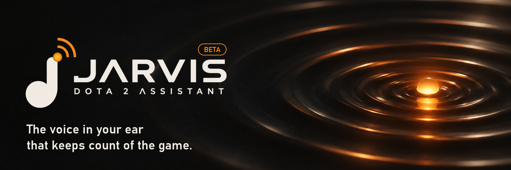

  <b>Stop counting. Start playing.</b> 
  Jarvis keeps track of the timers, cooldowns and builds you keep forgetting, and shows you your whole Dota career. 
  Free. For Windows. In English and Ukrainian.

> [!NOTE]
> **Jarvis is in beta.** Things will break, and some features are still being tuned on real games.
>
> **Tell us what you think.** What should be better? What is missing? What should go? [Open an issue](../../issues): every idea helps.

  <b><a href="../../releases/latest">Download the latest version</a></b>

  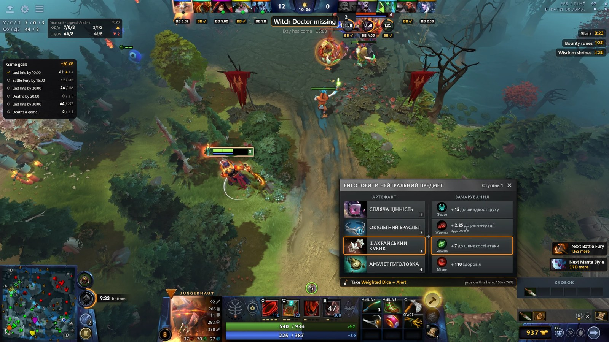

## In the match

- **A voice in your ear:** runes, Roshan, Tormentor, stacks, lotuses, wisdom shrines, glyphs, enemy buybacks, outposts, said in time to act. Or short sounds, if you prefer them.
- **Under the portraits:** enemy ultimate cooldowns, buybacks, the Aegis, key items.
- **On Dota's own buttons:** the timers of Roshan, the Tormentor, Scan and Glyph.
- **Who is missing:** an enemy gone from your minimap is called out and marked where you last saw them.
- **What to level, what to buy, which neutral item to craft:** right on the game's own buttons and panels.
- **Where to ward:** one key shows where pros ward for your side at this minute. Statistics, never the enemy's real wards.
- **Your screen, your arrangement:** drag any layer and pull its edge to resize it. Any format, ultrawide too.

## Your whole account

Every game you have played, for the last week, month, year or all time, ranked or all.

| | |
|---|---|
| 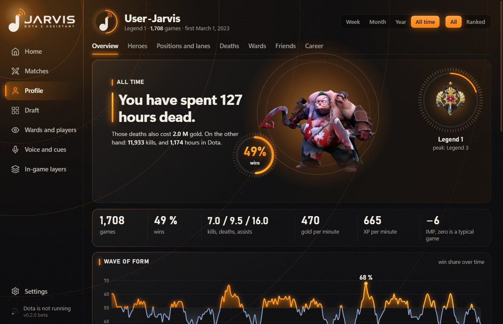 | 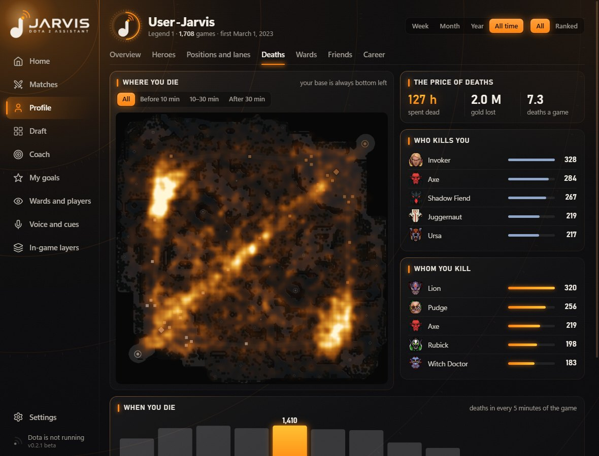 |
| **Overview.** Your numbers, a wave of form, a calendar, the days and hours you win, a lifetime counter. | **Deaths.** Where and when you die, who kills you, whom you kill, what it costs. |
| 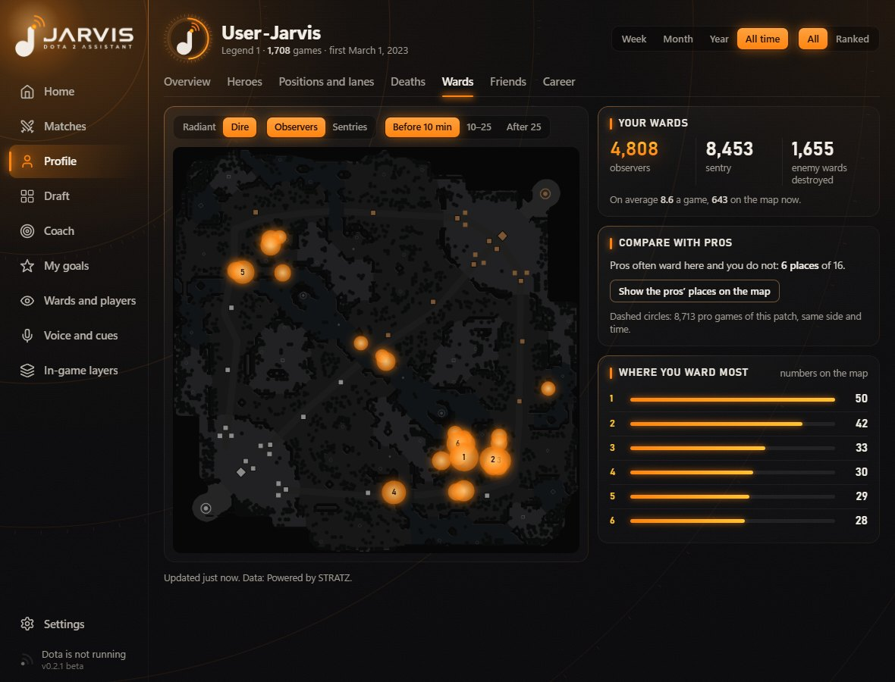 | 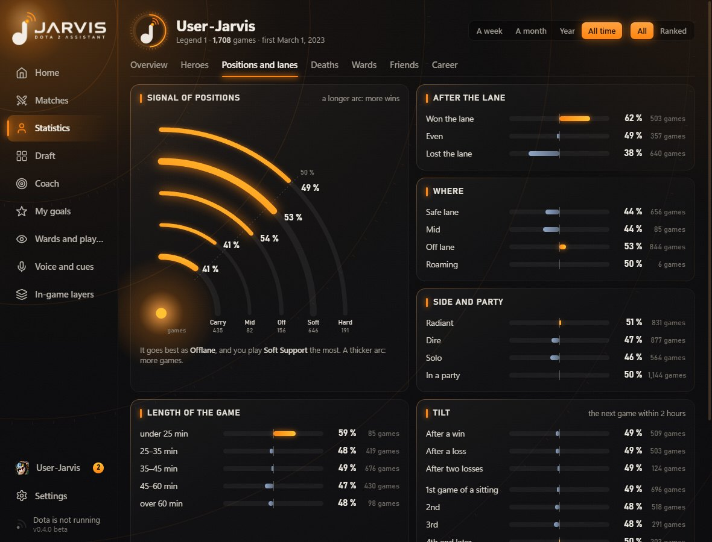 |
| **Wards.** Your own spots by side and time, next to where pros ward. | **Positions and lanes.** Carry to support, lanes, solo or party, game length, tilt, farm. |
| 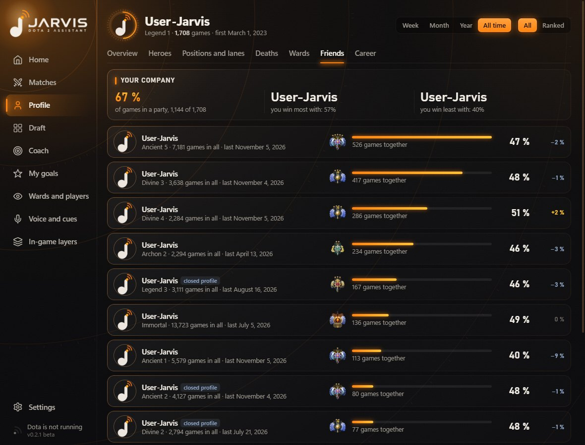 | 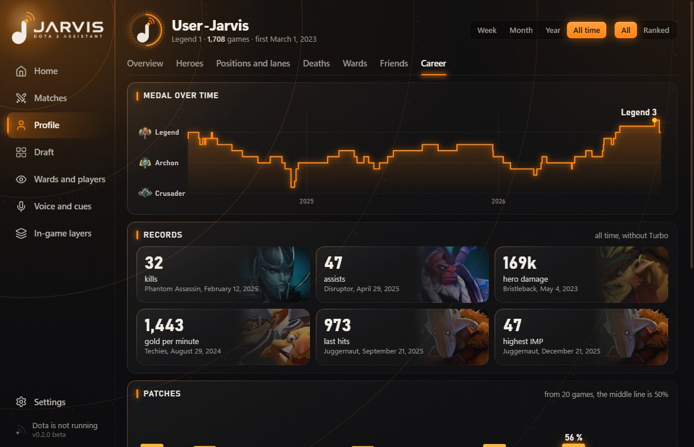 |
| **Friends.** Whom you queue with and how often you win together. Click one for their statistics and your best hero pairs. | **Career.** Your medal over time, records, patches, streaks. |

## Before and after a match

| | |
|---|---|
| 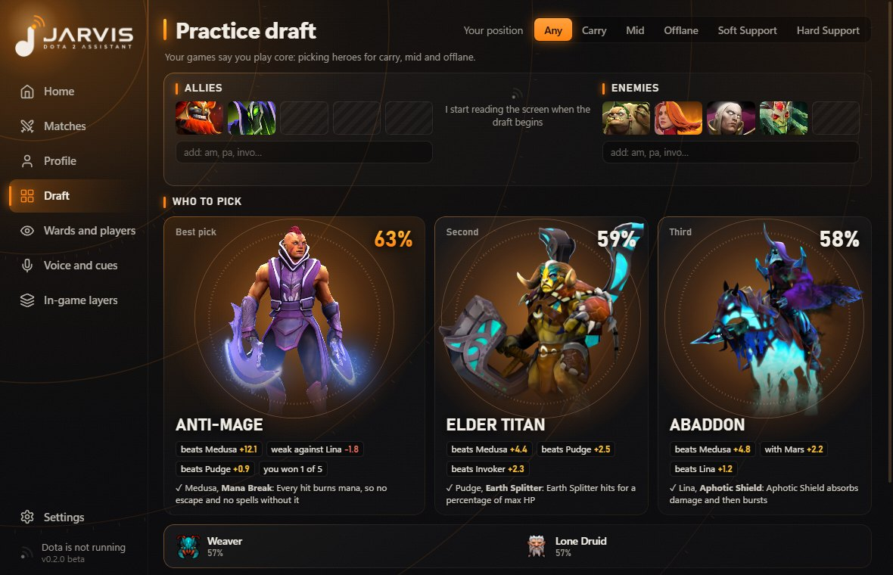 | 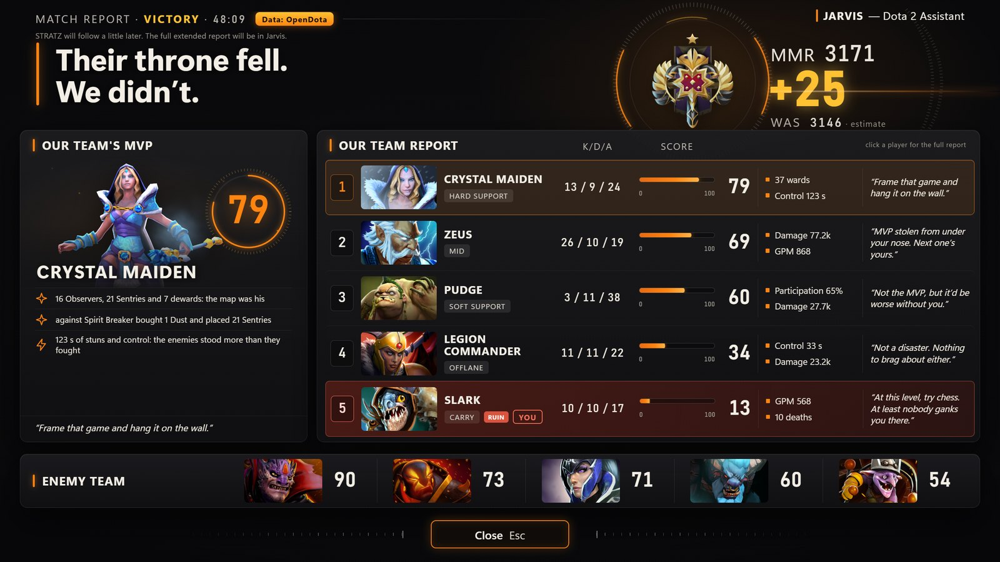 |
| **Draft help.** The best picks with a reason you can read. Hero statistics only, never information about players. | **The post-game show.** Your team's MVP and its biggest letdown, fair scores for every position, praise and roasts. |
| 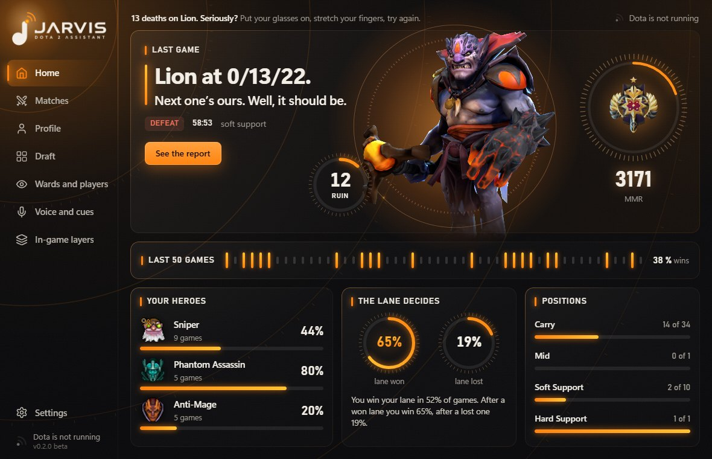 | 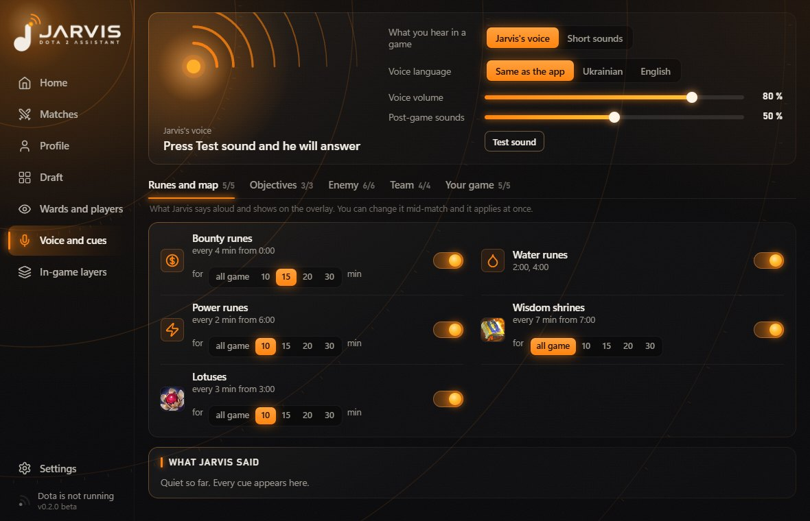 |
| **Home.** Your last game, your form, your heroes at a glance. | **Voice and cues.** Turn every cue on or off and choose the language Jarvis speaks. |

Real pictures of the app. Nicknames and avatars are replaced with "User-Jarvis".

**Learn from any player:** enter a Friend ID to see where their wards stand, their main heroes, builds and habits. Public data, only for an ID you type yourself.

## Built to play fair

Jarvis uses Valve's official Game State Integration, public match statistics from OpenDota and STRATZ, and the picture and sound of your own game.

**What it never does**

- Reads the game's memory or injects anything into it
- Changes game files
- Presses a key, clicks or buys anything for you
- Shows you anything the game hides: fog stays fog
- Looks up the other players before or during the draft

**The honest part.** Valve does not certify third-party apps, so nobody can truthfully promise you zero risk. Valve has not said anything specific about reading hero portraits off the screen in the draft, so you can turn that off in the settings.

## Your data stays yours

- **No keys inside.** Jarvis ships with no API keys and needs no account of its own.
- **Your own STRATZ token.** At first start Jarvis asks for your own free token. Windows encrypts it on your PC, and it is only ever sent to STRATZ.
- **No telemetry and no server of ours.** Recordings, reports and settings stay on your computer. Jarvis only talks to Valve's image servers for pictures, to OpenDota and STRATZ for public match data, and to GitHub to check for new versions.
- **Help with testing, if you want to.** One button in the settings packs logs and recent match recordings into an archive on your desktop. You decide whether to send it.

## Getting started

**[Download the latest version](../../releases/latest)** and run `Jarvis-Dota-2-Setup-*.exe`.

1. The app is not code-signed yet, so Windows may warn you: choose **More info**, then **Run anyway**.
2. Follow the short setup when Jarvis first opens: your language, your free STRATZ token, connecting Dota.
3. Set Dota's display mode to **Borderless window**, so Jarvis can draw over the game. In exclusive full screen you still get the voice.
4. Play. Jarvis tells you when it has connected.

Tested on Windows 11. When a new version is out, Jarvis offers it when it starts, never during a match.

## About this repository

This page and the ready-to-install builds live here. The source code is closed.

---

Jarvis is an independent fan project. It is not affiliated with or endorsed by Valve. Dota 2 is a trademark of Valve Corporation.
