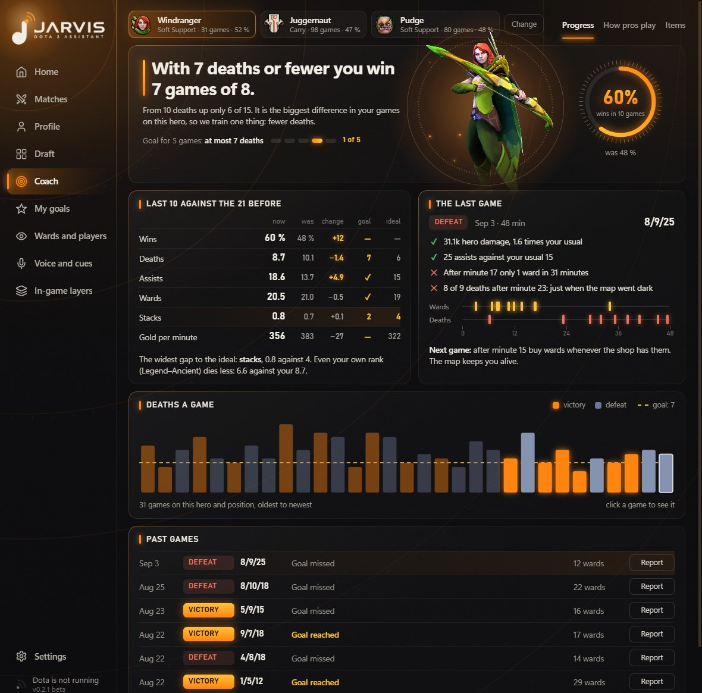
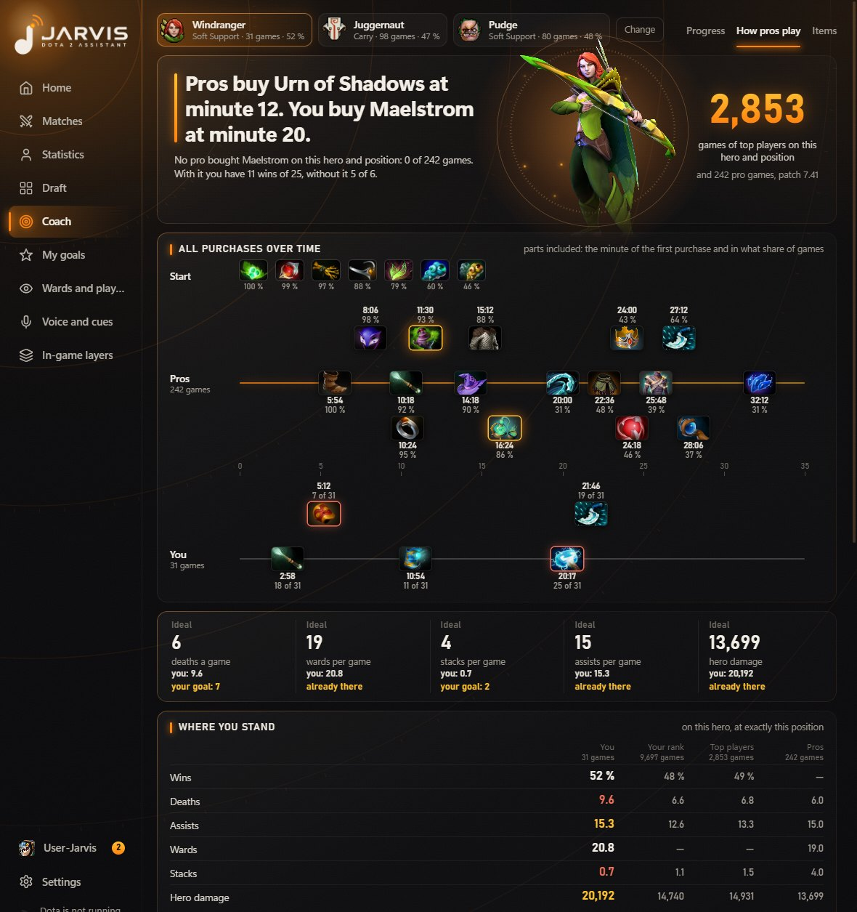
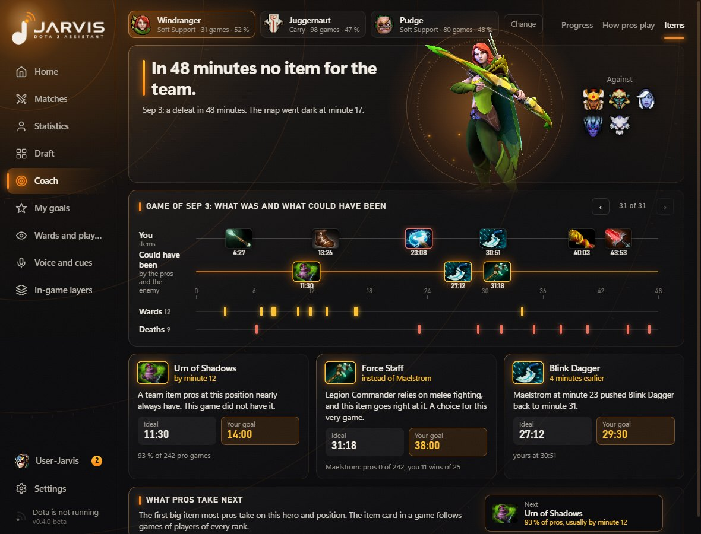
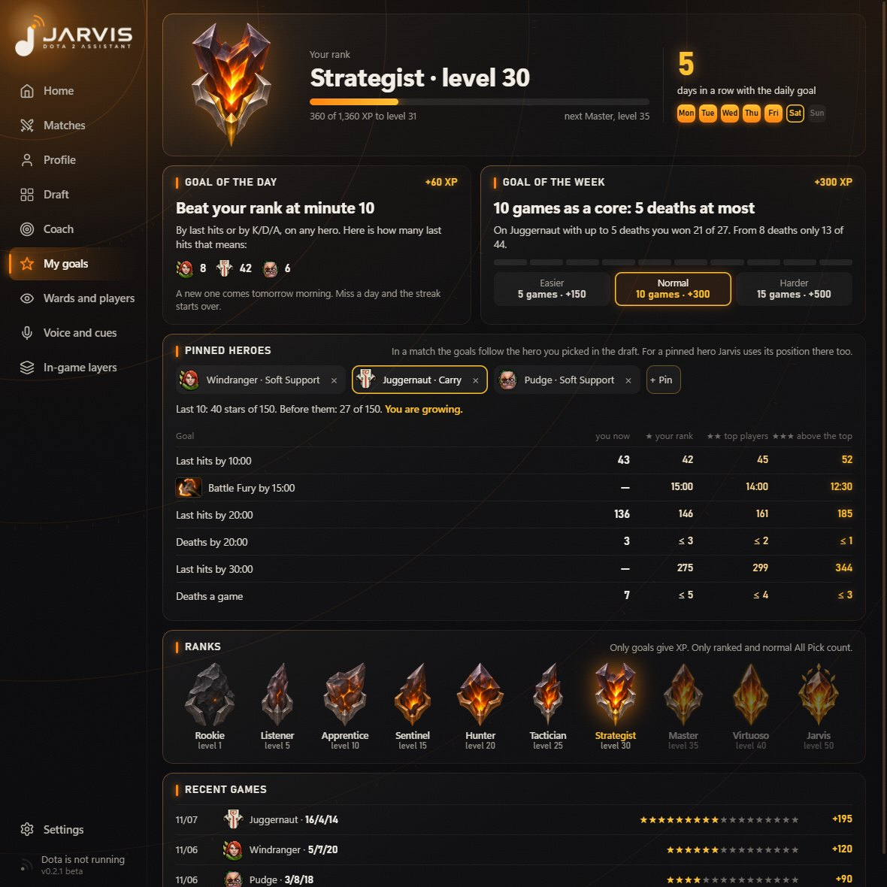
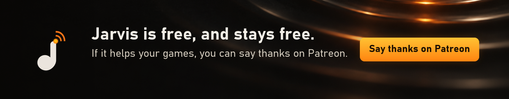

  

  <b>Your own games already know why you lose.</b> 
  Jarvis finds the one thing that decides your wins, sets you goals for every match, and talks you through the game in your ear. 
  Free. For Windows. In English and Ukrainian.

> [!NOTE]
> **Jarvis is in beta.** Things will break, and some features are still being tuned on real games.
>
> **Tell us what you think.** What should be better? What is missing? What should go? [Open an issue](../../issues), or find us on [Discord](https://discord.gg/xDRNshPtt7) and [Telegram](https://t.me/JarvisDota2Bot): every idea helps.

  <b><a href="../../releases/latest">Download the latest version</a></b>

  

## A coach who has read all your games

  

Pick up to three heroes. Jarvis goes through **your own games** and finds the number that really decides them, like *"With 7 deaths or fewer you win 7 games of 8."* Then you train just that one thing.

- **After every game:** what worked, what did not, and one thing to do next time.
- **How pros play your hero at your position:** every purchase on one clock, parts included, with you right beside them.
- **Ideal and your goal:** for each number, what the best do and your next real step towards it.
- **Your rank, top players, pros:** side by side with you, at exactly your position.
- **Game by game:** what you bought, and what was worth buying against those enemies.

| | |
|---|---|
|  |  |
| **How pros play.** All their purchases, your numbers beside the rank's, the top players' and the pros'. | **Items.** One game at a time: what you bought, what was worth buying, ideal times and your goal. |

## Goals for every match

  

- **Goals that follow your pick:** last hits by a minute, your key item, deaths, kills and assists. The numbers come from thousands of real games on that hero and position.
- **Three stars:** one for what your rank does, two for top players, three for beating them.
- **Live on your screen,** with a soft sound when you earn a star.
- **XP for goals, not for wins.** A good game counts even when your team throws. Levels and ten ranks, from a stone to a blazing crystal.
- **A goal of the day** (be ahead of your rank at minute 10, minute 5 in Turbo) **and of the week** (taken from your own games), and a streak to keep.
- **Pin your heroes** and see whether you are growing on each of them.
- **Fair:** ranked and normal All Pick count in full, Turbo counts at half with its own Turbo numbers, bots and lobbies never.

## With friends

- **Add friends** by their Jarvis ID or nickname: their rank, profile and who is in Jarvis right now.
- **Your rank in Discord:** link Discord and get a role with your rank on our server.
- **Your progress lives in your account,** so it survives a new PC. With Steam linked, Steam confirms your games are really yours.

## In the match

- **A voice in your ear:** runes, Roshan, Tormentor, stacks, lotuses, wisdom shrines, glyphs, enemy buybacks, outposts, said in time to act, with Turbo's own timers in Turbo. Or short sounds, if you prefer them.
- **Your chance to win:** a thin bar under Dota's score, from the draft, the kills and the clock. Not shown in Turbo, with bots or in a lobby.
- **You against your rank:** beside Dota's own numbers, your K/D/A and last hits next to what your rank has on this hero at this very minute.
- **Under the portraits:** enemy ultimate cooldowns, buybacks, the Aegis, and up to six items you saw on an enemy, with any cooldown Dota showed you.
- **On Dota's own buttons:** the timers of Roshan, the Tormentor, Scan and Glyph.
- **Who is missing:** an enemy gone from your minimap is called out and marked where you last saw them.
- **What to level, what to buy, which neutral item to craft:** on or beside the game's own buttons and panels. The item card also suggests an answer to a particular enemy and says why.
- **Where to ward:** one key goes through your chosen player's wards, the pros', and where the enemy usually wards. Statistics, never the enemy's real wards.
- **Your screen, your arrangement:** drag any layer and pull its edge to resize it. Other formats, ultrawide too, are worked out from Dota's own layout rules, and a layer can go to a second monitor.

## Your whole account

Every game you have played, for the last week, month, year or all time, ranked or all.

| | |
|---|---|
|  |  |
| **Overview.** Your numbers, a wave of form, a calendar, the days and hours you win, a lifetime counter. | **Deaths.** Where and when you die, who kills you, whom you kill, what it costs. |
|  |  |
| **Wards.** Your own spots by side and time, next to where pros ward. | **Positions and lanes.** Carry to support, lanes, solo or party, game length, tilt, farm. |
|  |  |
| **Friends.** Whom you queue with and how often you win together. | **Career.** Your medal over time, records, patches, streaks. |

## Before and after a match

| | |
|---|---|
|  |  |
| **Draft help.** The best picks with a reason you can read. Hero statistics only, never information about players. | **The post-game show.** Your team's MVP and its biggest letdown, fair scores for every position, praise and roasts. |

**A full match review:** open any of the ten players for the chance to win minute by minute, why that score, deaths and kills on the map, gold, wards and items. The review comes from whichever of STRATZ and OpenDota reads the match first; the minute-by-minute chance, maps, gold, wards and items over time come from STRATZ with your token.

Real pictures of the app on real games. Nicknames and avatars are replaced with "User-Jarvis", and the level on the goals picture is an example. Jarvis's layers hide from screen capture, so the in-game picture is put together: a frame of the game with the layers drawn for its numbers, and sample timers under the portraits.

**Learn from any player:** enter a Friend ID to see where their wards stand, their main heroes, builds and habits. Public data, only for an ID you type yourself.

## Getting started

**[Download the latest version](../../releases/latest)** and run `Jarvis-Dota-2-Setup-*.exe`.

1. The app is not code-signed yet, so Windows may warn you: choose **More info**, then **Run anyway**.
2. Follow the short setup when Jarvis first opens: your language, a Jarvis account (Steam, Google or e-mail), your free STRATZ token, connecting Dota.
3. Set Dota's display mode to **Borderless window**, so Jarvis can draw over the game. In exclusive full screen you still get the voice.
4. Play. Jarvis tells you when it has connected.

Tested on Windows 11. When a new version is out, Jarvis offers it when it starts, never during a match.

## Your data stays yours

- **A Jarvis account.** It keeps your nickname, progress and friends on our server, so they survive a new PC. The app lists exactly what it keeps, and one button deletes it all.
- **No keys inside.** Jarvis ships with no API keys.
- **Your own STRATZ token.** At first start Jarvis asks for your own free token. Windows encrypts it on your PC, and it is only ever sent to STRATZ.
- **The rest stays on your PC.** Match recordings, reports and settings never leave your computer. Besides our server, Jarvis talks only to Valve's image servers for pictures, to OpenDota and STRATZ for public match data, and to GitHub to check for new versions.
- **Help with testing, if you want to.** One button in the settings packs logs and recent match recordings into an archive on your desktop. You decide whether to send it.

## Built to play fair

Jarvis uses Valve's official Game State Integration, public match statistics from OpenDota and STRATZ, and the picture and sound of your own game.

**What it never does**

- Reads the game's memory or injects anything into it
- Changes game files
- Presses a key, clicks or buys anything for you
- Shows you anything the game hides: fog stays fog
- Looks up the other players before or during the draft

**The honest part.** Valve does not certify third-party apps, so nobody can truthfully promise you zero risk. Valve has not said anything specific about reading hero portraits off the screen in the draft, so you can turn that off on the Draft page.

## Say thanks

Jarvis is free, and stays free. If it helps your games, you can thank the developer on Patreon.

  

## About this repository

This page and the ready-to-install builds live here. The source code is closed.

---

Jarvis is an independent fan project. It is not affiliated with or endorsed by Valve. Dota 2 is a trademark of Valve Corporation.
